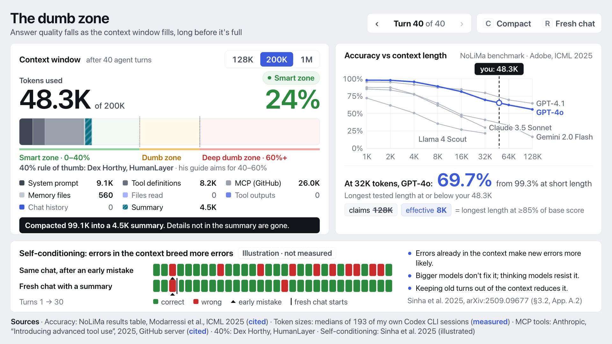

# The dumb zone: context meter demo

A one-screen live demo for the **dumb zone** law in the talk "AI is like a girlfriend that ghosts you in your context window" (Ashish Kumar Verma, 10 Oct 2026). It shows that answer quality falls as the context window fills, long before the window is full, and that errors already in the context breed more errors (self-conditioning).



## What the audience sees

1. **Context meter.** A stacked bar for one model's window (128K, **200K** default, or 1M). Its segments are the system prompt, tool definitions, MCP tools, memory files (AGENTS.md), files read, tool outputs and chat history. Step through turns 0–40 and the bar grows by the amounts measured from real agent sessions. The bar shows tokens used, percent used and the zone: green up to 40%, yellow to 60%, red beyond. The 40% rule of thumb is credited on screen to Dex Horthy (HumanLayer).
2. **Quality chart.** NoLiMa accuracy against context length (1K–128K, log scale) for five models. A dashed marker follows the meter's token count. The readout gives the measured score at the longest tested length at or below your context, for example "At 32K tokens, GPT-4o: 69.7% (from 99.3% at short length)". The claimed-vs-effective callout reads, for example, "claims 128K, effective 8K".
3. **Fix buttons.** **Compact** collapses chat, tool outputs and file reads into a summary the size real compactions leave behind (4.5K). The marker jumps left, quality recovers, and a note says "Details not in the summary are gone". **Fresh chat** returns to the 43.8K you pay before typing anything.
4. **Self-conditioning panel.** Two per-turn strips, "Same chat, after an early mistake" and "Fresh chat with a summary". The panel is labelled **"Illustration · not measured"**: it draws the pattern Sinha et al. 2025 report and carries no numbers.

Worth saying on stage: switch to the **1M** window at turn 40. The meter reads only 14% (green), but the chart still shows quality well down at 128K+. The zones are a share of the window; the damage is a function of absolute tokens.

## Run it

```sh
./serve.sh            # from the repo root, then open http://localhost:8000/dumb-zone/
```

If port 8000 is taken: `python3 -m http.server 8001 --bind 127.0.0.1` from the repo root, then open `http://localhost:8001/dumb-zone/`. The page needs a server only because it `fetch`es `data/codex-sessions.json`. Everything is local: no CDN, no fonts, no network. The chart and meter are plain SVG and DOM, so no third-party library is vendored. The stage is 1920×1080 and scales to fit the window.

| Key | Action |
|---|---|
| → / PageDown / Space | Next turn |
| ← / PageUp | Previous turn. Stepping back past a compaction undoes it. |
| C | Compact |
| R | Fresh chat (turn 0) |
| F | Fullscreen |
| Esc | Reset everything (200K, GPT-4o, turn 0) |
| W | Cycle window size: 128K → 200K → 1M |
| M | Cycle the highlighted model (or click a line's name) |
| Home / End | Turn 0 / turn 40 |

URL helpers for rehearsal and screenshots: `?turn=40`, `?win=128K`, `?compact`, `?still` (no motion). The page also respects `prefers-reduced-motion`.

## Where every number comes from

Each on-screen number is either **cited** (from a published source) or **measured** (from a run on this laptop). The footnote labels which is which.

### Cited

| On screen | Source |
|---|---|
| Accuracy at 1K–128K, base score, claimed length and effective length for GPT-4o, GPT-4.1, Gemini 2.0 Flash, Claude 3.5 Sonnet and Llama 4 Scout | NoLiMa results table, copied exactly from the README of [adobe-research/NoLiMa](https://github.com/adobe-research/NoLiMa). Paper: Modarressi et al., "NoLiMa: Long-Context Evaluation Beyond Literal Matching", ICML 2025, [arXiv:2502.05167](https://arxiv.org/abs/2502.05167). 64K and 128K exist only for GPT-4.1, GPT-4o and Gemini 2.0 Flash ("--" for the rest). The effective length is the longest context that keeps ≥85% of the base score. |
| MCP tools 26.0K | Anthropic, ["Introducing advanced tool use on the Claude Developer Platform"](https://www.anthropic.com/engineering/advanced-tool-use) (Nov 2025): "GitHub: 35 tools (~26K tokens)". |
| 40% and 60% zone lines | Dex Horthy (HumanLayer). He uses "dumb zone" for the range past about 40% of the window. His guide [Advanced Context Engineering for Coding Agents](https://github.com/humanlayer/advanced-context-engineering-for-coding-agents/blob/main/ace-fca.md) says to keep "utilization in the 40%-60% range". The demo draws yellow from 40% to 60% and red beyond. |
| Self-conditioning findings | Sinha et al. 2025, "The Illusion of Diminishing Returns: Measuring Long Horizon Execution in LLMs", [arXiv:2509.09677](https://arxiv.org/abs/2509.09677). §3.2: "models become more likely to make mistakes when the context contains their errors from prior turns"; "scaling model size does not mitigate self-conditioning"; Fig. 6: "Qwen3 models with thinking enabled no longer self-condition". App. A.2: shrinking the context the model sees "reduces the self-conditioning effect". The red and green strips are a hand-drawn illustration of this pattern. They are not data, and the panel says so. |

### Measured: 193 of the speaker's Codex CLI sessions

`experiment/measure_codex_sessions.py` reads the Codex CLI logs on this laptop (`~/.codex/sessions`, 556 files; 193 sessions remain after dropping forks and sub-agents). It writes **aggregate token counts only, no log content** to `data/codex-sessions.json`. The context size at each model call is Codex's own `last_token_usage.input_tokens`. Text Codex logs verbatim (base instructions, AGENTS.md, compaction summaries) is counted with tiktoken's `o200k_base`.

| On screen | Value | How |
|---|---|---|
| System prompt | 9.1K | Median base instructions (3,257) plus median harness developer messages (5,820, such as permissions and collaboration mode) |
| Tool definitions | 8.2K | Median of (first-call context minus every logged text before the first call). Derived, because Codex doesn't log the tool schemas. |
| Memory files | 560 | Median AGENTS.md size in the 35 sessions that had one |
| Files read, tool outputs, chat history (per turn) | 0 → 23.7K, 63.2K, 12.2K at turn 40 | Median context growth since the first call at each turn (one turn is one model call). It covers the sessions that reached that turn without compacting: 193 at turn 1, 96 at turn 40. Growth is split by the share of characters appended: file-reading commands, other tool outputs, and messages plus tool-call text. It's held non-decreasing (running maximum) so the bar never shrinks between turns; the raw medians dip by at most 1.3K. |
| Compaction summary | 4.5K | Median of (context at the first call after a compaction minus that session's first call), over 234 compactions. The summary text alone is a median 1,132 tokens; the rest is the recent messages Codex keeps. Before a compaction, context was a median 219K; after it, 23K. |
| Sessions count in the footnote | 193 | |

Also in the JSON but not on screen: 88 of these 193 sessions went past 40% of their window, and the median session made 45 model calls.

Because each segment is its own median, the turn-0 total (43.8K: 17.8K measured plus the cited 26K MCP) isn't the median first call (20.3K, which has no MCP). Turn *t* means the median session after *t* model calls. It's a typical trajectory, not one real session replayed.

### Self-conditioning: why the panel is an illustration

The plan was to measure self-conditioning locally with a short replication of Sinha et al.'s running-sum task (`experiment/self_conditioning.py`, Qwen2.5-3B-Instruct converted to MLX 4-bit). Qwen3-4B-Instruct-2507 was only a stub in the local Hugging Face cache, so the 3B model was used. The pilots, one rollout each, showed the model can't do the task even in a fresh chat:

| Pilot | Fresh-chat turns correct |
|---|---|
| 2 keys per turn, 100-word dictionary | 1 of 12 |
| 1 key, 100 words | 2 of 12 |
| 1 key, 20 words | 1 of 16 |

With accuracy that close to zero, there's no contrast left for self-conditioning to show. Local model runs were then paused because the laptop was running out of memory alongside another session's experiment. So the panel shows the published finding, clearly labelled, and no numbers were invented for it. The script records turn accuracy as the paper defines it ("the state update from turn t−1 to turn t is correct, regardless of the correctness of the model's state at turn t−1") for three conditions: same chat, same chat with an injected early mistake, and fresh chat with a summary. It's ready for a stronger local model.

## Caveats to say out loud if asked

- NoLiMa measures finding one fact in long, unrelated text with minimal word overlap. It's a lower bound on how hard long context is, not a coding-agent benchmark. Real agent context is more relevant to the task, which can help or hurt.
- The readout never interpolates. It quotes the measured score at the longest tested length at or below your context. Past a model's last tested length, it says so.
- The token sizes come from Codex CLI (GPT-5-family models, roughly 350K windows) on one person's laptop. Other agents and other people's habits differ. The cited Anthropic figure sets the MCP size.

## Files

```
index.html                 stage markup (1920×1080, scaled to fit)
ui/style.css               visual language copied from demo/ui/style.css, extended
ui/data.js                 NoLiMa table, segment config, illustration pattern, source URLs
ui/app.js                  token model, meter, SVG chart, keys
data/codex-sessions.json   measured aggregates (regenerate below)
experiment/                measurement scripts
screens/                   1-start, 2-about-40-percent, 3-red-zone, 4-after-compact (1920×1080)
```

Regenerate the measured data. This uses only the tokenizer, no model:

```sh
uv venv dumb-zone/.venv --python 3.11 && uv pip install --python dumb-zone/.venv/bin/python tiktoken
TIKTOKEN_CACHE_DIR=dumb-zone/.cache/tiktoken dumb-zone/.venv/bin/python dumb-zone/experiment/measure_codex_sessions.py
```

`.venv/` and `.cache/` stay inside `dumb-zone/` and are gitignored.
