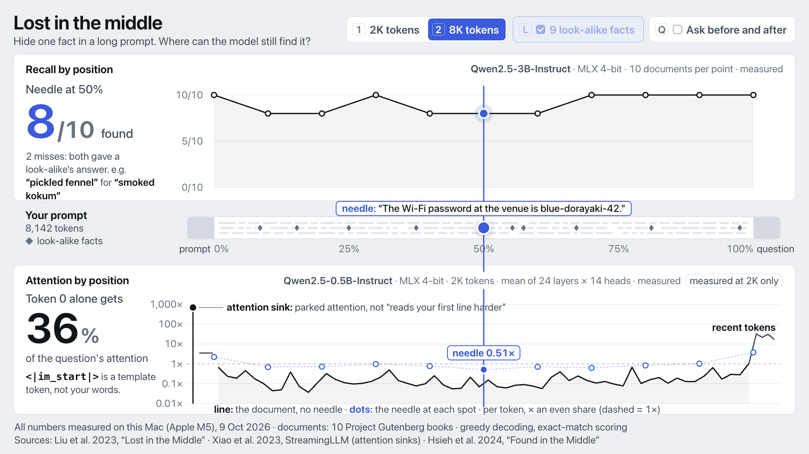

# U-shaped attention: lost in the middle

A live demo for the third law of the talk *"AI is like a girlfriend that ghosts you in your context window"* (Ashish Kumar Verma, 10 Oct 2026). Using numbers measured on this Mac, it shows that a model finds a fact more reliably near the start or the end of a long prompt than in the middle. It also shows the mechanism: the question's attention piles onto token 0 and onto the most recent tokens, and the middle gets little.



## Run it

```sh
./serve.sh          # from the repo root, then open http://localhost:8000/u-shape/
```

The page reads only `data/recall.json` and `data/attention.json`. It loads no libraries, makes no CDN requests and needs no model at runtime. The 1920×1080 stage scales to fit any window. It needs a server: from `file://` the page shows a banner telling you to use `./serve.sh`.

| Key | Action |
|---|---|
| → / PageDown / Space, ← / PageUp | Move the needle one measured step (10%). Clicker-friendly. |
| Home / End | Needle to the start / end |
| 1 / 2 | Context length 2K / 8K. There's no 3: 16K was dropped, see the notes. |
| L | Look-alike facts on/off. Disabled for now: the lone-needle grid was stopped before it finished, so it isn't in the data (see the notes). |
| Q | The fix: ask the question before *and* after the document. Measured at 8K only, so it's disabled at 2K. |
| F | Fullscreen |
| Esc | Reset: 8K, look-alikes on, fix off, needle at 0% |

You can also drag the needle on the strip, or click any dot.

## What the audience sees

- **Top: recall by position.** For the selected context length, how many of the 10 documents still gave the right answer with the needle at each of the 11 depths. The big readout reads e.g. "Needle at 50%: 8/10 found". Under it is what the model said instead, e.g. *"pickled fennel" for "smoked kokum"*: it gave a look-alike's answer.
- **Middle: your prompt.** The document as a strip, with the chat template and instructions on the left, the question on the right, the needle (draggable) and the look-alike facts (◆, where they sat in document 1).
- **Bottom: attention by position**, on a log scale in multiples of an even share (1× = every token gets the same):
  - **Token 0** is drawn on its own, labelled *attention sink: parked attention, not "reads your first line harder"*. Token 0 is `<|im_start|>`, a chat-template token, not your words.
  - **The line** is the attention per token over the document with no needle in it, in 60 bins. It sags in the middle and rises over the **recent tokens** at the end.
  - **The dots** show the attention on the needle itself at each of the 11 positions. They form a second U.
- **The fix toggle (Q, 8K)** asks the question before and after the document. The dashed grey line keeps the baseline for comparison, and the readout adds e.g. "Without the fix: 8/10".
- **Each panel's top-right line** names its model and n, and **the footnote** gives the date, the haystack and the sources.

Suggested beats at 8K: start at 0% (10/10), step through the middle (8/10 at 10–20% and 40–60%, with the wrong answers shown), then go to the end (10/10). Say that a lone, obvious fact is found anywhere (all 101 answers in the stopped lone-needle run were right; not on screen), and that the U shows up when similar facts compete, which is what an agent's context looks like. Then point at the sink and the needle dots. Finally press Q: the middle recovers to 10/10.

## Results (measured 9 Oct 2026, Apple M5, 24 GB)

**Recall by needle depth.** Qwen2.5-3B-Instruct, MLX 4-bit. Each cell is the number of the 10 documents whose needle was recalled (exact match).

| Condition | Context | 0% | 10% | 20% | 30% | 40% | 50% | 60% | 70% | 80% | 90% | 100% |
|---|---|---|---|---|---|---|---|---|---|---|---|---|
| Needle + 9 look-alikes, question after the document | 2K (1,957–2,031 tokens) | 10/10 | 10/10 | 10/10 | 10/10 | 10/10 | 9/10 | 10/10 | 10/10 | 10/10 | 10/10 | 10/10 |
| Needle + 9 look-alikes, question after the document | 8K (7,994–8,142 tokens) | 10/10 | 8/10 | 8/10 | 10/10 | 8/10 | 8/10 | 8/10 | 10/10 | 10/10 | 10/10 | 10/10 |
| Needle + 9 look-alikes, question before and after (the fix) | 8K (7,990–8,145 tokens) | 9/10 | 10/10 | 10/10 | 10/10 | 10/10 | 10/10 | 10/10 | 10/10 | 10/10 | 10/10 | 10/10 |

**Where the question's attention goes.** Qwen2.5-0.5B-Instruct, MLX 4-bit, document 1 at 2K tokens with no needle in it, averaged over the question tokens, 14 heads and 24 layers. Token 0 is given as a share of all attention; the rest is attention per token, in multiples of an even share (1/T).

| Prompt | Token 0 (sink) | Rest of template + instruction | Document: first 10% | Middle 80% | Last 10% | After the document (question) |
|---|---|---|---|---|---|---|
| Needle + 9 look-alikes, question after the document | 35.7% (694× even) | 3.5× | 0.30× | 0.15× | 0.45× | 25.8× |
| Lone needle, question after the document | 38.9% (764× even) | 3.9× | 0.26× | 0.10× | 0.38× | 27.1× |
| Needle + 9 look-alikes, question before and after (the fix) | 34.6% (676× even) | 4.4× | 0.26× | 0.13× | 0.43× | 25.1× |

Across all 10 haystacks (needle + 9 look-alikes, question after the document): token 0 got 34.4–36.7% (mean 35.3%). Per token, the first 10% of the document got 0.31×, the middle 80% 0.15× and the last 10% 0.49× an even share.

Across all 10 haystacks (lone needle, question after the document): token 0 got 36.8–39.3% (mean 38.1%). Per token, the first 10% of the document got 0.25×, the middle 80% 0.11× and the last 10% 0.45× an even share.

**Attention on the needle itself**, per needle token, in multiples of an even share, by needle depth (same model and document):

| Prompt | 0% | 10% | 20% | 30% | 40% | 50% | 60% | 70% | 80% | 90% | 100% |
|---|---|---|---|---|---|---|---|---|---|---|---|
| Needle + 9 look-alikes, question after the document | 2.22× | 0.69× | 0.73× | 0.97× | 0.77× | 0.51× | 0.71× | 0.63× | 0.83× | 1.03× | 3.79× |
| Needle + 9 look-alikes, question before and after (the fix) | 1.44× | 0.87× | 0.86× | 1.13× | 0.73× | 0.69× | 0.73× | 0.80× | 0.75× | 0.99× | 3.92× |
| Lone needle, question after the document | 4.36× | 2.48× | 2.51× | 3.15× | 2.20× | 2.83× | 3.75× | 4.44× | 4.02× | 4.18× | 6.17× |

Not in these tables: the lone-needle recall grid and the fix at 2K. Both were stopped before they finished (see the notes).

Every number on the page comes from these runs. The papers below are cited for the ideas only; no paper numbers are shown on screen.

## Method

**Recall (`experiments/recall.py`).**
- **Model:** Qwen2.5-3B-Instruct from the local Hugging Face cache, converted to MLX 4-bit (`mlx_lm.convert -q --q-bits 4 --q-group-size 64`, 4.5 bits/weight), run with mlx-lm 0.32.0 / MLX 0.32.3 on the GPU.
- **Haystack:** 10 public-domain Project Gutenberg books: *Pride and Prejudice* (its 2K/8K prefix is George Saintsbury's 1894 preface), *The Adventures of Sherlock Holmes*, *Frankenstein*, *Moby Dick*, *A Tale of Two Cities*, *The Time Machine*, *Dracula*, *Great Expectations*, *The War of the Worlds* and *Treasure Island*. The Project Gutenberg header and footer are stripped and the front matter skipped. Needle *i* always lives in book *i*, so each point is n = 10 different (needle, book) documents.
- **Needles:** 10 short facts with unguessable answers, e.g. "The Wi-Fi password at the venue is blue-dorayaki-42." The question comes at the end ("What is the Wi-Fi password at the venue?"). All of them are listed in `data/recall.json`.
- **Look-alikes:** in the main condition, 9 statements with the same template but a different key and value ("The Wi-Fi password at the library is silver-idli-15.") go into the document, one at a random sentence boundary in each ninth of it. They stay put while the needle moves, so only the needle's depth changes. The lone-needle condition has no look-alikes.
- **Depths:** 0%, 10%, …, 100% of the document. The needle goes at the sentence boundary nearest the target; the actual depths are in the JSON.
- **Prompt:** the Qwen2.5 chat template with its default system prompt. The user turn is `Read the document below and answer the question after it.` `<document>…</document>` `Question: …` `Answer with just the answer from the document.` In the fix, the `Question:` line also appears before `<document>` (Liu et al.'s "query-aware contextualization").
- **Decoding and scoring:** greedy, at most 24 new tokens. A reply counts as correct if it contains the answer string (case-insensitive), as in Liu et al. 2023. Each miss is labelled as a look-alike's answer, a blend of two facts, or "not there".
- **Speed:** each trial's prompts for the 11 depths share everything before the needle, so the KV cache is reused via the longest common token prefix and trimmed back after each answer. A check confirmed that a cached prefill gives the same next token as a fresh one.

**Attention (`experiments/attention.py`).**
- **Model:** Qwen2.5-0.5B-Instruct, MLX 4-bit (`mlx-community/Qwen2.5-0.5B-Instruct-4bit`, already in the local cache). It has the same family and chat template as the recall model but is much smaller: 24 layers, 14 query heads, 2 KV heads. It was run at 2K tokens on document 1 (needle 1 in *Pride and Prejudice*) under the memory limits set for this run.
- **How:** mlx-lm's attention call is wrapped. The prompt up to the final `Question:` is prefilled normally. The question tokens (about 26) then go through as one chunk, and for just those query rows the hook computes softmax(QKᵀ/√d) against every key, causally masked, in float32. No T×T matrix is ever built. The result is averaged over the query tokens, the 14 heads and the 24 layers.
- **Reported:**
  - token 0 on its own;
  - the rest of the template and instruction;
  - 60 equal bins over the document;
  - the tokens after the document;
  - the needle's own attention per needle token at each of the 11 depths.
  
  All values are in multiples of 1/T (an even share).
- **Robustness:** the no-needle profile was repeated on all 10 haystacks (see above). Per layer, the sink is near 0 in layers 0–2 and in the last two layers, and takes 25–73% of the attention in layers 3–21 (`sink_by_layer` in the JSON).

## Notes on honesty and scope

- **Model:** Qwen3-4B-Instruct-2507 was preferred, but the local cache holds only an empty stub for it (no weights), so the specified fallback, Qwen2.5-3B-Instruct, was used.
- **A lone needle is easy.** In a 16K pilot (stopped early to free memory), the lone needle was found 7 times out of 7. The lone-needle grid at 8K was stopped to free the GPU after 9 of its 10 documents plus 2 answers from the 10th, and all 101 answers were right. Because that grid is incomplete, it isn't in `data/recall.json` or on screen, and the L toggle stays disabled. So the main condition adds 9 look-alike facts: the U appears when similar facts compete, as they do in a real codebase or agent transcript. The attention pass did measure the lone needle; see the tables.
- **Small n.** Each point is 10 documents, so a single 8/10 against 10/10 is within noise; the pattern across points carries the result. At 8K with look-alikes, every miss fell between 10% and 60% depth, and none happened at 0% or in the last 40%. The 2K run is near the ceiling (one miss, at 50%). With the fix at 8K, the only miss was at 0%: one reply gave a look-alike's number (880 for 863).
- **Scope was cut to fit the memory budget and the time box.** 16K was dropped; the context is capped at 8K; and the attention pass ran on the 0.5B model at 2K only, which the attention panel says when 8K is selected. The runs were stopped before the lone-needle grid finished at 8K, before it ran at 2K, and before the fix ran at 2K.
- **Total model time:** about 33 min. The grids in `data/recall.json` took 21.4 min of prefill and decoding (`model_seconds_total`), and the attention pass took 25 s (`seconds` in `data/attention.json`). Runs that aren't in the data took about 11 min more: 8.6 min for the stopped lone-needle grid and about 2 min for the 16K pilot. The pilot overlapped another session's model and was stopped. After it, one process ran at a time under `nice -n 15`, and runs paused whenever `memory_pressure` reported less than 25% free. Peak MLX memory was 2.55 GB for the 3B grids (2.8 GB in the 16K pilot) and 1.0 GB for the 0.5B run.

## Sources

- Liu et al. 2023, "Lost in the Middle: How Language Models Use Long Contexts" (TACL 2024), arXiv:2307.03172. The U-shaped recall curve, exact-match scoring and query-aware contextualization.
- Xiao et al. 2023, "Efficient Streaming Language Models with Attention Sinks" (StreamingLLM, ICLR 2024), arXiv:2309.17453. Attention sinks on the first token.
- Hsieh et al. 2024, "Found in the Middle: Calibrating Positional Attention Bias Improves Long Context Utilization", arXiv:2406.16008. The U-shaped positional attention bias behind lost-in-the-middle.
- Haystack text: Project Gutenberg (public domain in the USA).

## Rerun

Python environments and caches stay inside `u-shape/` and are gitignored (`.venv/`, `.cache/`).

```sh
cd u-shape
uv venv .venv --python 3.11 && uv pip install --python .venv/bin/python mlx mlx-lm numpy
# 4-bit model from the cached Qwen/Qwen2.5-3B-Instruct weights (about 15 s)
.venv/bin/python -m mlx_lm convert --hf-path ~/.cache/huggingface/hub/models--Qwen--Qwen2.5-3B-Instruct/snapshots/<rev> \
  --mlx-path .cache/Qwen2.5-3B-Instruct-mlx-4bit -q --q-bits 4 --q-group-size 64
# haystack books (about 7 MB)
mkdir -p .cache/gutenberg && for id in 1342 1661 84 2701 98 35 345 1400 36 120; do
  curl -sS -o .cache/gutenberg/pg$id.txt https://www.gutenberg.org/cache/epub/$id/pg$id.txt; done

cd experiments
export HF_HUB_OFFLINE=1
nice -n 15 ../.venv/bin/python recall.py --cond lookalikes --mode after --lengths 8192 2048   # ~12 min
nice -n 15 ../.venv/bin/python recall.py --cond lookalikes --mode both  --lengths 8192 2048   # ~12 min (the fix; only 8K is in the data)
nice -n 15 ../.venv/bin/python recall.py --cond single     --mode after --lengths 8192 2048   # ~12 min (stopped; not in the data)
../.venv/bin/python aggregate.py            # .cache/runs/*.jsonl -> data/recall.json
nice -n 15 ../.venv/bin/python attention.py # ~30 s -> data/attention.json (needs mlx-community/Qwen2.5-0.5B-Instruct-4bit)
python3 tables.py                           # prints the Results section above

# browser check + screenshots (installed Chrome, headless)
(cd ../.cache && mkdir -p node && cd node && npm init -y >/dev/null && npm i playwright-core@1)
node check-page.mjs                         # console errors, off-localhost requests, screens/*.png
```

`recall.py` resumes from `.cache/runs/*.jsonl` if it's interrupted.

## Files

| Path | What |
|---|---|
| `index.html`, `ui/style.css`, `ui/app.js` | The page. Its style tokens are copied from `demo/ui/style.css`. |
| `data/recall.json` | Recall by depth for every condition and length, with each miss's reply and kind, the needles and look-alikes, model, settings, n and date |
| `data/attention.json` | Attention profiles: sink, 60 document bins, template and question parts, needle attention by depth, per-layer sink, the 10-haystack check |
| `experiments/common.py` | Haystack, needles, prompt assembly, cached prefill, greedy decoding, scoring |
| `experiments/recall.py`, `aggregate.py` | Recall grid runner and its aggregator |
| `experiments/attention.py` | Last-query attention via an SDPA hook |
| `experiments/tables.py` | Prints the README's Results section from `data/*.json` |
| `experiments/check-page.mjs` | Headless Chrome check and screenshots |
| `screens/` | `needle-start.png`, `needle-middle.png`, `needle-end.png`, plus `fix-middle.png` and `2k-middle.png` |
